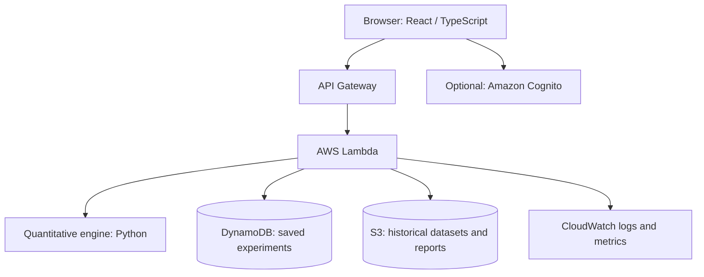

# FinShock Quant — Flexible Project Idea & Basic Implementation Plan

## 1. The idea

**FinShock Quant** is a web-based quantitative-finance research lab for exploring portfolio risk and investment scenarios.

A user creates a hypothetical portfolio, chooses assets and allocations, and experiments with market conditions. The application visualizes how different assumptions affect portfolio value, risk, and possible outcomes.

The goal is to build an impressive, interactive demonstration of quantitative finance while using AWS for selected cloud capabilities. It is an educational and analytical tool, **not financial advice or a trading platform**.

The concept is intentionally flexible. The exact asset classes, models, interface, data sources, and AWS services can be chosen during development.

## 2. Possible features

Treat these as options, not fixed requirements. Start with a small core and add features only when useful.

- **Portfolio builder:** Enter a starting amount, choose assets, and set allocation weights.
- **Scenario testing:** Apply hypothetical market shocks—for example, equities fall while gold rises—and visualize the resulting portfolio value.
- **Monte Carlo simulation:** Generate many possible portfolio outcomes using estimated returns, volatility, and optionally correlations.
- **Risk metrics:** Explore measures such as volatility, maximum drawdown, Value at Risk (VaR), and Conditional Value at Risk (CVaR).
- **Portfolio comparison:** Compare simple allocation strategies, such as equal-weight and minimum-variance portfolios.
- **Efficient frontier:** Optionally visualize the relationship between portfolio risk and expected return.
- **Historical analysis and backtesting:** Compare a model's estimates against historical data.
- **Saved experiments and reports:** Save scenarios and compare results across runs.

A compelling presentation could start with a hypothetical ₹10 lakh portfolio, apply a market-shock scenario, and show how the value and risk measures change. A Monte Carlo distribution or efficient-frontier chart could then demonstrate the more advanced analysis.

## 3. Basic architecture

One possible architecture is shown below. It is a starting point, not a mandatory design.

### Potential technology choices

- **Frontend:** React and TypeScript; use a charting library such as Plotly or Recharts.
- **Quantitative engine:** Python, NumPy, pandas, and SciPy where appropriate.
- **API/backend:** AWS Lambda and API Gateway, if supported by your account and suitable for the workload.
- **Persistence:** DynamoDB for compact records such as saved portfolios and experiment metadata; S3 for files and datasets.
- **Authentication:** Cognito if sign-in is needed. Since the first version is for one user, authentication can be kept simple, but don't expose a public API without suitable access controls.
- **Deployment:** AWS SAM or CloudFormation are options for reproducible infrastructure deployment.
- **Data:** Start with a small, documented historical dataset or CSV files. A live market-data API is optional and introduces availability, licensing, and rate-limit considerations.

You do not need to use every service. Local computation during development is fine. The final design should use AWS services where they add value and meet the assignment's requirements.

## 4. AWS constraints and cost guardrails

The project must be designed around the actual AWS account and Free Tier/Free Plan available to you—not an assumption that every AWS service is free.

- **Check your account plan first.** AWS offers differ by account age and plan. New Free Plan accounts currently have a limited exploration period and credits; existing accounts may be under different terms. Confirm your account's eligibility and limits in the AWS Billing and Free Tier consoles.
- **Free allowances are service-specific.** A service may have a monthly free allowance, a time-limited trial, or no applicable free offer for your account. Usage beyond applicable allowances can incur charges on a paid account.
- **Credits are not a universal spending cap.** Confirm which services are eligible and monitor usage and credit expiry.
- **Avoid always-on infrastructure initially.** Prefer a small serverless prototype over continuously running virtual machines, containers, databases, or other resources that may accrue charges while idle.
- **Avoid expensive optional components.** Do not make paid AI models, managed financial-data feeds, GPU workloads, or premium analytics services essential to the first version.
- **Keep simulations bounded.** Let the user choose a reasonable simulation count and enforce a maximum. Test computation locally before deploying it to Lambda, whose execution time and memory are limited.
- **Use small datasets.** Store only the history needed for the demo; avoid unnecessary high-frequency data collection.
- **Secure resources.** Use least-privilege IAM permissions, avoid embedding credentials in source code, and don't expose storage buckets or APIs publicly without a deliberate access design.
- **Set up cost visibility.** Review the Billing/Free Tier dashboards and configure available budget or usage alerts. Alerts help you notice usage; they are not necessarily a hard spending cap.
- **Clean up after experiments.** Delete unneeded resources and review logs, storage, API usage, and other services before leaving the project running.
- **Check regional availability and pricing.** Confirm that the services and features you choose are available and eligible in your intended AWS Region.

Official starting points:
- [AWS Free Tier overview and eligibility](https://docs.aws.amazon.com/awsaccountbilling/latest/aboutv2/free-tier.html)
- [Choosing an AWS account plan](https://docs.aws.amazon.com/en_en/awsaccountbilling/latest/aboutv2/free-tier-plans.html)
- [Tracking Free Tier usage](https://docs.aws.amazon.com/us_en/awsaccountbilling/latest/aboutv2/tracking-free-tier-usage.html)
- [AWS Lambda pricing](https://aws.amazon.com/lambda/pricing/)

**Practical constraint:** Since this is a single-user assignment, optimize for a reliable, polished demonstration rather than multi-tenant scale. You can describe how the architecture could grow later without building that complexity now.

## 5. A flexible implementation plan

### Phase 1 — Define the smallest useful version
Choose a small set of assets, a starting portfolio value, and one scenario. Decide which outputs the first demo must show. Keep the scope adjustable.

### Phase 2 — Build and test the quantitative core locally
Implement portfolio return calculations and one risk-analysis method. Use small, reproducible examples and tests to check that the results make sense. Keep assumptions and limitations documented.

### Phase 3 — Build the visual interface
Create a portfolio editor, scenario controls, and charts. Make the baseline-versus-stress comparison easy to understand during a presentation.

### Phase 4 — Add one advanced quantitative feature
Choose a feature such as Monte Carlo simulation, an efficient frontier, or VaR/CVaR. Add it only after the core calculations and interface work reliably.

### Phase 5 — Add AWS integration
Choose the smallest set of services that satisfies the assignment. For example, deploy an API and computation function, then add persistence if saved experiments are needed. Authentication, scheduled work, and other services can remain optional.

### Phase 6 — Validate and prepare the demonstration
Test normal and extreme inputs, document the dataset and model assumptions, verify the results, and rehearse a short demo. Confirm AWS usage and clean up unused resources.

## 6. Important quantitative-finance considerations

- Historical returns are estimates, not guarantees of future performance.
- Monte Carlo results depend on the selected return distribution and model assumptions.
- Correlations can change during market stress; a simple model may understate risk.
- VaR describes a loss threshold at a selected confidence level; CVaR estimates average losses in the tail beyond that threshold, subject to the chosen convention and estimator.
- Backtesting can reveal model weaknesses, but a limited historical period does not establish that a model will work in the future.
- Clearly label simulated results and avoid presenting the application as a source of guaranteed returns or personalized investment advice.

## 7. What success looks like

A strong first submission should be able to:

1. Accept a user-defined hypothetical portfolio.
2. Apply a clearly specified market scenario.
3. Calculate and visualize the changed portfolio value.
4. Demonstrate at least one correctly implemented quantitative risk feature.
5. Explain the model's assumptions and limitations.
6. Show meaningful AWS usage without relying on costly services or uncontrolled workloads.
7. Be deployed and demonstrated reproducibly.

## 8. Keep these decisions open

These choices can be made as the project develops:

- Indian assets, global assets, or a mix.
- Historical-only data or optional live data.
- Which risk measures and simulation models to implement.
- Whether portfolio optimization belongs in the first version.
- Which AWS services are required by the assignment and affordable under the account's actual limits.
- Whether the interface is a research dashboard, a guided experiment, or a combination.
- How much authentication, persistence, and infrastructure automation the final submission needs.

**Suggested starting point:** Build a local prototype that lets you enter a portfolio, apply a market shock, and view the resulting value and one risk metric. Once that works, decide which quantitative feature and AWS components best fit your assignment, time, and account limits.
